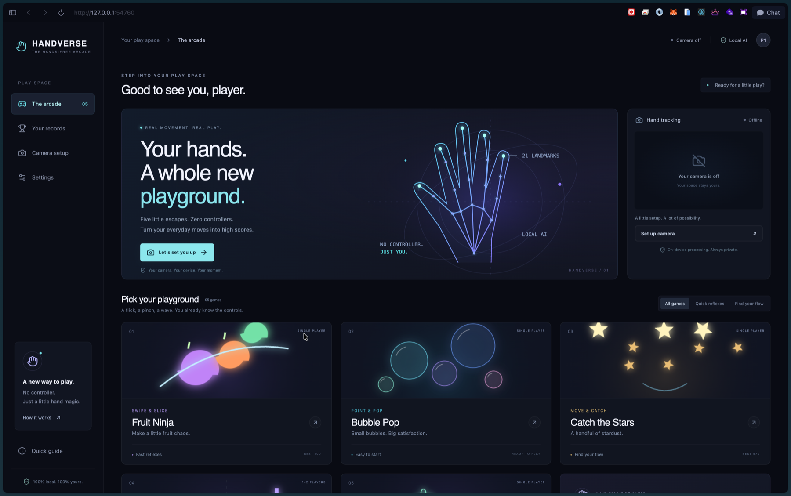
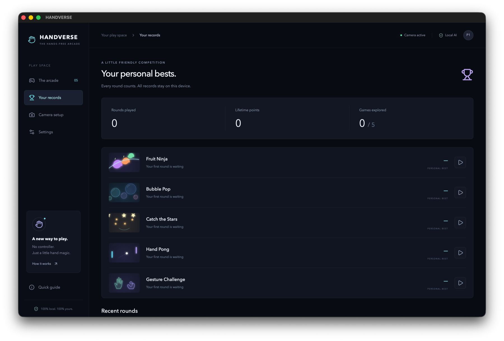

# HANDVERSE — The Hands-Free Arcade

HANDVERSE is a desktop arcade you play with your hands. A webcam and on-device hand tracking replace the mouse, keyboard and controller: point to move, pinch to click, swipe to slice.

Everything runs locally. Camera frames never leave your machine, and the app needs no server, API key or internet connection after installation.





## Contents

- [Features](#features)
- [Games and controls](#games-and-controls)
- [Install](#install)
- [First run](#first-run)
- [Build from source](#build-from-source)
- [Release build with GitHub Actions](#release-build-with-github-actions)
- [Architecture](#architecture)
- [Project layout](#project-layout)
- [Testing](#testing)
- [Privacy](#privacy)
- [Troubleshooting](#troubleshooting)
- [License](#license)

## Features

- Real-time tracking of up to two hands, 21 landmarks each, with MediaPipe Hand Landmarker.
- App-wide hand cursor: navigate menus, settings and games without a mouse.
- Pinch-to-click with hysteresis and a cooldown, so one pinch is one click.
- Optional dwell-click: hover over a button for about 1 second to press it.
- Gesture recognition: open palm, fist, pointing and pinch.
- Five-point calibration that maps your comfortable hand range to the whole screen.
- Five mini-games, a pointer practice mode, and local high scores.
- Fully offline: the model and the WebAssembly runtime are embedded in the app binary.
- GPU inference with automatic CPU and non-SIMD fallbacks.

## Games and controls

| Game | Control | Goal |
| --- | --- | --- |
| **Fruit Ninja** | Swipe your index finger fast through fruit | Slice fruit, avoid bombs. Missed fruit costs a life. |
| **Bubble Pop** | Point at a bubble | Pop as many bubbles as you can in 60 seconds. Small bubbles score more. |
| **Catch the Stars** | Move your palm left and right | Catch falling stars with the basket. Avoid red danger stars. |
| **Hand Pong** | Move your palm up and down | First to 7 points wins. Turn on two-player mode in Settings to let a second hand control the other paddle. |
| **Gesture Challenge** | Hold the requested pose (open palm, fist, pinch, pointing) | Match each prompt before the timer runs out. Prompts speed up as your score grows. |

All games have pause (Esc or the pause button), restart, and a combo multiplier. If your hand leaves the camera for more than 1.5 seconds, the game pauses automatically. **Practice mode** lets you play any game with the mouse, so you can learn it before you use the camera.

## Install

Download installers from [GitHub Releases](https://github.com/h-yusuf/handverse-ai/releases). Open the latest version and expand **Assets**. The "Source code" archives are not installers.

| Platform | File | Notes |
| --- | --- | --- |
| macOS, Apple Silicon (M1 or newer) | `HANDVERSE_<version>_aarch64.dmg` | macOS 12 or newer |
| Windows 10/11 x64 | `HANDVERSE_<version>_x64-setup.exe` (recommended) or `HANDVERSE_<version>_x64_en-US.msi` | Install only one of the two |

### macOS

1. Open the `.dmg` and drag **HANDVERSE** into **Applications**.
2. Open HANDVERSE from Applications.
3. If macOS blocks the app because it is from an unidentified developer, open **System Settings → Privacy & Security**, scroll down, and click **Open Anyway** for HANDVERSE. Unsigned test builds are ad-hoc signed, not notarized.
4. When the app asks for camera access, click **Allow**.

### Windows

1. Run `setup.exe`. It installs for the current user and does not need administrator rights.
2. If SmartScreen shows "Windows protected your PC", click **More info → Run anyway**. Do this only for builds you downloaded from this repository's Releases.
3. The installer contains the WebView2 runtime, so it also works on offline machines.
4. Make sure **Settings → Privacy & security → Camera → Let desktop apps access your camera** is on.

### Requirements

- A webcam (the built-in camera is fine).
- A CPU or GPU that can run MediaPipe WebAssembly. An Apple M-series Mac or any recent Windows laptop is enough.
- Good, even lighting improves tracking a lot.

## First run

1. Open **Camera setup** and click **Set up camera**. The app selects the built-in camera by default; you can choose another camera there.
2. Wait for the status to show **Camera active** and "1 hand detected".
3. Raise one hand. The cursor follows the tip of your index finger.
4. Pinch your thumb and index finger together to click.
5. Optional: run **Calibration**. Pinch on each of the five targets so the cursor can reach every corner of the screen.
6. Go to **The arcade** and pick a game.

Settings (sound, skeleton overlay, dwell-click, two-player Pong, particles) and records are saved on your device only.

## Build from source

### Prerequisites

- Node.js 22 and npm
- Rust stable (`rustup`)
- Platform tools from the [Tauri prerequisites guide](https://v2.tauri.app/start/prerequisites/):
  - macOS: Xcode Command Line Tools (`xcode-select --install`)
  - Windows: Visual Studio C++ Build Tools and the Windows 10/11 SDK

### Commands

Run all app commands inside `app/`. That folder is the Tauri project root: `Cargo.toml`, `tauri.conf.json` and `build.rs` live there, next to the frontend.

```sh
git clone https://github.com/h-yusuf/handverse-ai.git
cd handverse-ai/app

npm ci                 # installs dependencies and verifies the pinned MediaPipe runtime and model
npm run build          # builds the frontend into dist/
npm run tauri dev      # runs the desktop app from dist/
```

`tauri.conf.json` has no `devUrl`, so `tauri dev` loads the built `dist/` folder. Run `npm run build` again after you change frontend code.

Production builds:

```sh
npm run check:ci                                   # version, assets, frontend, tests, cargo check
npm run tauri build -- --bundles dmg               # macOS installer
npm run tauri build -- --bundles nsis,msi          # Windows installers
```

Output:

- macOS: `app/target/release/bundle/dmg/` and `app/target/release/bundle/macos/HANDVERSE.app`
- Windows: `app/target/release/bundle/nsis/` and `app/target/release/bundle/msi/`

Useful scripts:

| Command | What it does |
| --- | --- |
| `npm run setup:tracking` | Copies the pinned MediaPipe runtime into `public/` and checks the model's SHA-256. Runs automatically after `npm ci`. |
| `npm run build` | Type-checks TypeScript and builds the frontend into `dist/`. |
| `npm test` | Runs the Vitest unit tests. |
| `npm run check:release` | Checks that the version is the same in `package.json`, `package-lock.json`, `Cargo.toml`, `Cargo.lock` and `tauri.conf.json`. |
| `npm run check:ci` | Runs all of the above plus `cargo check --locked`. Logs go to `app/logs/`. |

A browser preview (`npx vite`) is useful for UI work, but it does not test native camera permissions or packaging.

## Release build with GitHub Actions

The workflow [`.github/workflows/release.yml`](.github/workflows/release.yml) ("Desktop release") builds the installers and publishes them to GitHub Releases.

### Triggers

- **Push a version tag** such as `v1.0.0`: builds all platforms and publishes a release.
- **Run workflow** (manual `workflow_dispatch`) on a branch: builds and uploads artifacts only, without publishing a release.

### Jobs

```
prepare  ──►  build (macOS ARM64, Windows x64 in parallel)  ──►  publish
```

1. **prepare** (Ubuntu): checks that all version numbers match the tag, generates release notes from `app/docs/RELEASE-NOTES.md`, and creates a **draft** release.
2. **build** (matrix):

   | Runner | Rust target | Installers |
   | --- | --- | --- |
   | `macos-15` | `aarch64-apple-darwin` | `.dmg` |
   | `windows-latest` | `x86_64-pc-windows-msvc` | NSIS `.exe`, `.msi` |

   Each build job:
   - installs Node 22 and stable Rust, then runs `npm ci`;
   - runs `npm run check:ci` (version, assets, frontend, tests, Rust);
   - applies optional code signing when the secrets below exist;
   - builds with [`tauri-apps/tauri-action`](https://github.com/tauri-apps/tauri-action) and uploads installers to the draft release;
   - runs `scripts/check-bundles.mjs`, which requires the installer files and extracts the six embedded tracking assets from the binary to compare them byte-for-byte with `app/public/`;
   - keeps installers and check logs as workflow artifacts for 14 days, also when the job fails.
3. **publish**: makes the draft release public, but only when every build job passed. A failed run leaves the draft for inspection.

### Publish a new version

1. Update the version to the same value in `app/package.json`, `app/package-lock.json`, `app/Cargo.toml`, `app/Cargo.lock` and `app/tauri.conf.json`.
2. Edit `app/docs/RELEASE-NOTES.md`.
3. Check, commit and tag:

   ```sh
   npm --prefix app ci
   npm --prefix app run check:ci
   git commit -am "release: v1.0.1"
   git push origin main
   git tag -a v1.0.1 -m "HANDVERSE 1.0.1"
   git push origin v1.0.1
   ```

4. Watch the run under **Actions → Desktop release**. When it finishes, the installers appear under **Releases**.

Do not move or reuse a published tag. Use a new version for changed source.

### Optional signing secrets

Add these in **Settings → Secrets and variables → Actions**. Without them the workflow still builds, but the installers are unsigned (macOS uses an ad-hoc signature).

| Platform | Secrets |
| --- | --- |
| macOS signing and notarization | `APPLE_CERTIFICATE` (base64 `.p12`), `APPLE_CERTIFICATE_PASSWORD`, `APPLE_SIGNING_IDENTITY`, `APPLE_ID`, `APPLE_PASSWORD` (app-specific password), `APPLE_TEAM_ID` |
| Windows code signing | `WINDOWS_CERTIFICATE` (base64 `.pfx`), `WINDOWS_CERTIFICATE_PASSWORD` |

Incomplete secrets make the build fail on purpose, so a release is never silently unsigned. Never commit certificates or passwords. See [app/docs/RELEASING.md](app/docs/RELEASING.md) for details.

## Architecture

```
Webcam ──► getUserMedia (640×480, 30 fps)
             │
             ▼
       MediaPipe Hand Landmarker (WASM, GPU ► CPU, SIMD ► non-SIMD)
             │  21 landmarks per hand
             ▼
       GestureMachine (input.ts)
         pinch with hysteresis, gesture classification,
         cursor smoothing, calibration mapping
             │
     ┌───────┴──────────┐
     ▼                  ▼
TrackingLayer      GameView + Engine
app-wide cursor,   games read hand positions
pinch / dwell      every animation frame
click
```

- **Frontend**: React 18, TypeScript, Vite. Games render on an HTML Canvas 2D.
- **Native shell**: Tauri 2 (Rust). It serves the embedded assets with the correct MIME types and returns 404 instead of an HTML fallback for missing runtime files.
- **Adaptive quality**: when inference takes longer than 40 ms, tracking drops from 30 to 15 fps, and returns to 30 fps when inference is faster than 24 ms.
- **Security**: a strict Content Security Policy allows only local scripts and WebAssembly. There are no remote hosts.

## Project layout

```
handverse-ai/
├── .github/workflows/release.yml   CI: build and publish installers
├── docs/screenshots/               README images
└── app/                            Tauri project root
    ├── Cargo.toml, build.rs, tauri*.conf.json
    ├── src/
    │   ├── main.rs                 Rust entry point and asset handling
    │   ├── App.tsx                 pages: arcade, records, camera, settings, help
    │   ├── GameView.tsx            game loop and HUD
    │   ├── TrackingLayer.tsx       app-wide hand cursor
    │   ├── games/                  engine, physics, render
    │   └── services/               vision, mediapipe, input, storage, audio
    ├── public/                     pinned MediaPipe runtime and model (tracked in Git)
    ├── scripts/                    setup and CI check scripts
    ├── tests/                      Vitest unit tests
    └── docs/                       releasing, testing, validation, third-party notices
```

The `app/src-tauri/` folder is an unused starter template and is ignored by Git. Do not use it in place of the root crate in `app/`.

## Testing

```sh
cd app
npm test            # unit tests: gestures, hand navigation, MediaPipe loading, camera lifecycle
npm run check:ci    # full local CI check
```

The packaged app also has automation flags:

- `--runtime-test <report.json>`: starts the real WebView, initializes the model and runs inference on a blank canvas.
- `--self-test <report.json>`: runs the gameplay and runtime checks.
- `--audit-runtime-assets <folder>`: extracts the embedded runtime assets without opening a window.

Automated checks do not replace a test with a real camera and real hands. The manual acceptance checklist is in [app/docs/TESTING.md](app/docs/TESTING.md), and the latest results are in [app/docs/VALIDATION.md](app/docs/VALIDATION.md).

## Privacy

- Camera frames are processed on your device. They are never recorded or uploaded.
- The camera starts only when you click to start it. Audio is never requested.
- Scores and settings are stored locally in the app.
- The app makes no network requests at runtime. Network access is needed only to install build dependencies.

## Troubleshooting

| Problem | Fix |
| --- | --- |
| "Camera permission was denied" | macOS: **System Settings → Privacy & Security → Camera**, turn on HANDVERSE. Windows: **Settings → Privacy & security → Camera**, allow desktop apps. Then click **Set up camera** again. |
| "Camera is busy" | Close other apps that use the camera (Zoom, Teams, browser tabs). |
| Hand is not detected | Improve the lighting, keep your whole hand in the frame, and stay about 40–80 cm from the camera. |
| Cursor cannot reach the screen edges | Run calibration in **Camera setup**. |
| Clicks are hard to trigger | Turn on dwell-click in **Settings**. |
| Tracking is slow | Close heavy apps. The app lowers its tracking rate on slow machines automatically. |

## License

No application license has been chosen yet, so the code is not licensed for reuse. Third-party components and their licenses are listed in [app/docs/THIRD-PARTY.md](app/docs/THIRD-PARTY.md).
